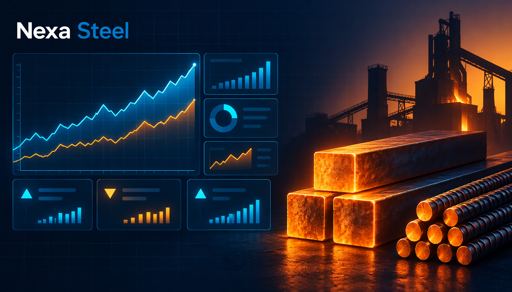

# Nexa Steel — Product Intelligence Cockpit

A self-contained, single-file analytics cockpit that turns three years of steel mill (rebar / MS rod) order-line data into an executive-ready read: realised **net / gross / MRP** price per tonne, SKU momentum, margin structure, competitor mill rates, market share, dealer commissions, regional growth, price elasticity, and a Direction·Decision·Action strategy layer. Every chart is hand-rolled SVG, the data is embedded as a JS object, and the whole thing opens from `file://` with no build step or server.



[](#) [](#) [](#)

## Quick start

```bash
# 1. Just open it
open index.html            # macOS  ·  start index.html  (Windows)
# 2. Or serve statically
npx serve .
# 3. Or the canonical copy
open "Nexa Steel Product Intelligence Cockpit.html"
```

No install, no bundler — the file is self-contained (the only external request is the Fira Sans / Fira Code Google Fonts link, which degrades to system fonts offline).

## What it does

- **Overview** — window KPIs, monthly revenue + active-SKU portfolio chart, price-direction breadth, full-history insights, top-8 SKU price journey.
- **Price** — net vs gross vs MRP per MT, per-SKU and blended, over the clean price window.
- **GP / NP / Net** — price→cost→GP→NP waterfall and net-price-vs-scrap-cost proxy.
- **All SKUs** — one sortable, searchable, filterable table with click-to-drill into month-on-month.
- **Declared price grid** — Trade (mill) rate vs realised, plus per-SKU realised-vs-declared gap.
- **Elasticity** — own-price β (log-log OLS), β-by-SKU bars, price-volume scatter, interpretation table.
- **Competitor / Market Share / Dealer / Area / Growth** — mill-rate survey ladder, share progression, commission-vs-sales, delivery-zone value, FY revenue.
- **Direction · Decision · Action** and **Where to Play · Whom to Play · How to Win** — strategy read-outs, each pairing an explanation with a proof table and a chart.

Charts and tables are all vanilla JS + SVG/CSS; tabs deep-link via the URL hash.

## Demo data

**All figures are synthetic placeholders for portfolio demonstration.** Revenue, price, volume, competitor rates, market-share and elasticity values were randomised from the original patterns while preserving structure, record counts and order of magnitude, so every chart and KPI still renders realistically. Company, competitor and ERP identifiers are fictional and the cockpit is presented on dark-navy, data-dense styling per the shared portfolio design spec. Nothing here reflects a real company's financials.

## Deploy

Import the folder into Vercel (preset: **Other**), leave build command blank, output directory as root — the static `index.html` is served as-is.

## License

Portfolio demonstration artifact. Built by Abir.
